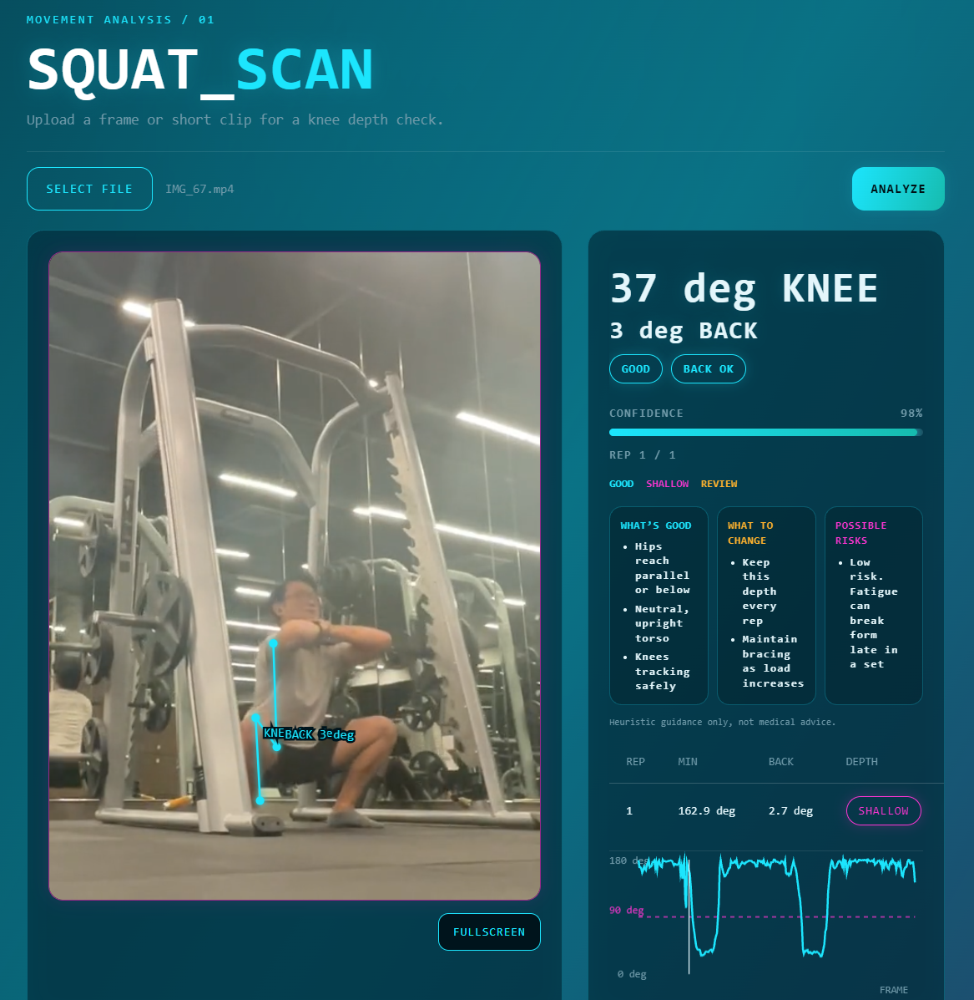

# 🏋️ Gym Movement Scanner

AI-powered squat form analysis from a photo or short video. Works from **front view** and **side view**.

### 👉 [Try the live demo](https://gym-movement-scanner.onrender.com)
> Hosted on a free server, so the first load can take ~50 seconds to wake up.



🎥 [Watch the demo video](Squat%20Scan%20Demo%20Video.mp4)

## ✨ Features
- Upload a JPG, PNG, or MP4 and get results in seconds
- Pose overlay with **knee angle** and **back angle**
- Automatic rep detection with depth verdict (GOOD / SHALLOW) per rep
- Knee-angle graph across the whole clip
- Works from front and side camera views

## 🛠️ Tech Stack


## 🚀 Run Locally
```bash
git clone https://github.com/zalvinz05/gym-movement-scanner.git
cd gym-movement-scanner
py -3.12 -m venv .venv
.venv\Scripts\activate
pip install -r requirements.txt
python app.py
```
Open http://127.0.0.1:5000

## 📁 Project Structure
```text
├── app.py              # Flask routes + pose/video analysis
├── requirements.txt    # Dependencies
├── Dockerfile          # Deployment (Render)
└── static/             # Frontend (HTML, JS, CSS)
```

## ⚠️ Known Limitations
- Rep counter can miss reps (e.g. counted 1 rep on a 2-rep clip)
- Estimates depend on camera angle, lighting, and full-body visibility
- Free hosting has limited memory, so keep clips under ~15 seconds
- Heuristic guidance only, **not medical advice**

## 🗺️ Future Work
- More accurate rep detection
- Real-time webcam mode
- More lifts (deadlift, lunge, push-up)
- Front-view specific checks (knee cave, left/right balance)

## 🤝 Contributing
This is an early POC and **feedback is welcome**! Test it with your own videos, open an issue if something's off, or fork it and send a pull request. Let's build this together.

## 📄 License
MIT, see [LICENSE](LICENSE).
